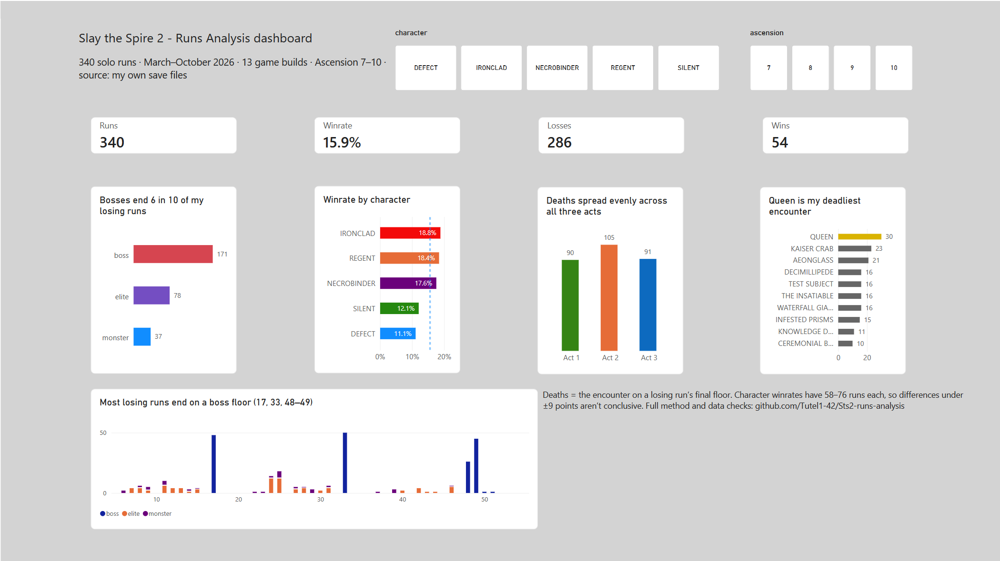

# Project Background

Slay the Spire 2 ia my favorite game that i play a lot in my free time and i notice the game saves a JSON file for every run. I want to see and analyze these run so this is the reason why this project exist. This project turns 340 of my solo runs (March to October 2026, 13 game builds) into a SQLite database and uses SQL, pandas and Power BI to answer questions about how I play: where I die, what I pick, when I heal and how I spend gold.

The aim was one project I could explain end to end: the data problems I hit, the choices I made, and how I checked the results.



## Findings

- **I win 54 of 340 runs (15.9%).** By character, winrates range from 11% (Defect) to 19% (Ironclad), but with 60 to 75 runs for each character the uncertainty is about ±9 percentage points, so the differences aren't conclusive.
- **Bosses end 6 in 10 of my losing runs** (171 of 286). The deadliest single encounter is the act 3 boss Queen (30 deaths).
- **I heal when I'm below about 30% HP, and at about 40% before a boss.** At 50–59% HP I heal 29% of the time before a boss and 5% of the time elsewhere. Based on 2,007 rest site visits where healing and upgrading were a real trade-off.
- **I spend 85–90% of the gold I bring to a shop.** In act 1, 79% of shop visits include a card; by act 3 that falls to 50%, and relics (54%) and card removal (51%) take over.
- **The unknown-room odds match the game's documented rules.** A simulation of the game's three "pity" counters predicts each room's odds from the rooms before it. Observed outcomes across 2,053 rooms match (χ² = 2.17, p = 0.54).

## How it works

```
.run files (JSON)  →  parser.py  →  sts2.db (SQLite, 8 tables)  →  analysis.ipynb  →  exports/*.csv  →  Power BI
```

`parser.py` reads every run and writes one table per kind of record:

| Table | One row is | Rows |
| --- | --- | --- |
| runs | one run | 340 |
| floors | one floor of a run | 11,309 |
| card_offers | one card I was shown | 21,667 |
| relic_offers | one relic I was shown | 6,872 |
| rest_choices | one choice at a rest site | 2,099 |
| shop_visits | one shop visit | 741 |
| final_deck / final_relics | one card or relic at the end of a run | 9,140 / 3,906 |

The notebook answers each question in SQL, with pandas and SciPy for the statistics. A final cell exports the results to CSV for the dashboard.

## Data problems I had to solve

The save files weren't designed for analysis. These are the ones that changed results:

- **No floor number.** I derive it from position in the run, and checked it against the floor each card was added.
- **One floor can hold two rooms.** Some events lead into a fight, which is stored as a second room. My first version read only the first room, so 52 fights went missing. A death that didn't match the game's "killed by" field exposed it.
- **Cards bought at shops aren't in the list of cards offered.** They only appear in the cards gained, so they're added separately. Without that, every shop card looks like it's never bought.
- **Reward screens aren't always 3 cards.** I first assumed every 6-card reward was two 3-card screens. Testing that across all 199 floors with extra cards found five different causes: two relics that add a reward screen, one that adds a 4th card, one that rerolls, and an enemy that returns a stolen card. I dropped the "screen" column instead of keeping one that was wrong.
- **Health percentages break in some runs.** One event sets max HP to 1, which makes every rest site look like "healing at full HP". Those visits are excluded, as are visits where a relic allowed healing and upgrading at the same time.

The full list of 18 quirks, the decisions and the validation checks are in my project notes.

## Choices worth explaining

- **Pickrate is picked ÷ offered**, not how often a card appears in winning decks. Winning runs are longer and collect more of everything.
- **Card results are compared within each character** ("lift" over that character's winrate), with starter cards excluded.
- **Trend analysis uses Ascension 10 only**, and marks patch boundaries rather than trying to remove them; one player's data can't separate skill from balance changes.
- **Co-op runs are excluded from analysis and from this repository.** They contain other players' Steam IDs.

## Repository

```
parser.py          builds sts2.db from data/runs
analysis.ipynb     all queries, tests and the CSV export
data/runs/         341 solo run files
exports/           CSVs used by the dashboard
dashboard/         Power BI file and screenshots
requirements.txt
```

## Running it

Requires Python 3.13 or 3.14 (Windows commands shown).

```
python -m venv .venv
.venv\Scripts\activate
pip install -r requirements.txt
python parser.py
```

Then open `analysis.ipynb` with the `.venv` kernel and run all cells. The dashboard file is `dashboard/sts2_dashboard.pbix` (Power BI Desktop).

## Related work

Tools like [STS Tracker](https://ststracker.app) and Spire Vault show aggregate stats across many players. This project looks at one player's decisions in depth and documents how the data was cleaned and checked.

Slay the Spire 2 is made by Mega Crit. This is an unofficial, non-commercial analysis of my own save data.
